[README.md](https://github.com/user-attachments/files/33898005/README.md)

  

  Hey, I'm <b>Oliver</b> (Yano Kurogawa). I build gameplay systems in <b>Unreal Engine 5</b> and <b>Unity</b>, 
  mostly movement, combat and multiplayer, and I keep iterating on a prototype until it actually feels good to play.

  

<!-- TODO: replace the links below with the repo or itch.io page of each project -->

  

  
  

  

  <b>Open for:</b> junior / entry-level roles · freelance work · collaborations

  
  
  
  
  

  

